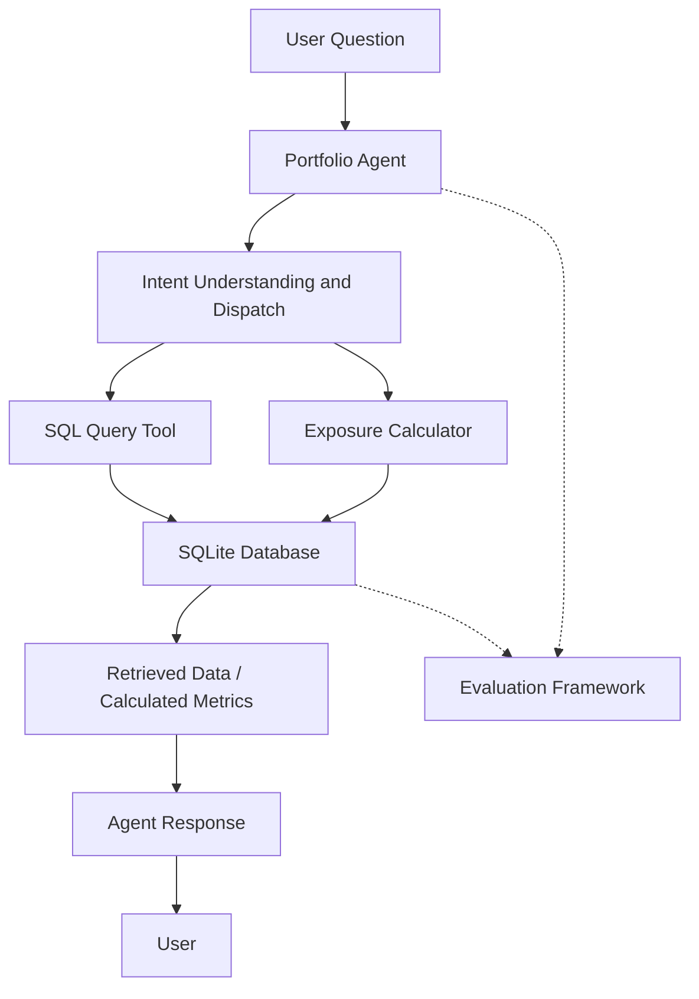

# PL Capital — Portfolio Analytics Agent

**An AI-powered portfolio analytics system that turns natural-language questions into meaningful financial insight**

---

## 1. What is this project?

Imagine a portfolio analyst working with hundreds of securities spread across multiple investment portfolios.

A manager asks:

- How many portfolios do we currently manage?
- Which portfolio has the highest exposure to the technology sector?
- What is the sector-wise distribution of a particular portfolio?
- How has a portfolio performed over a given period?
- Can you compare the exposure and performance of two portfolios?

Normally, answering these questions involves navigating datasets, writing SQL queries, joining multiple tables and performing calculations manually.

The **PL Capital Portfolio Analytics Agent** aims to simplify this process.

It is an AI-powered analytics system that allows users to interact with portfolio data using natural language. Instead of requiring users to understand the database structure or write SQL queries, they can ask questions in plain English and receive data-backed answers.

Behind the scenes, the agent identifies the intent of a question, selects the appropriate analytical tool, retrieves or calculates the required information and generates a response.

The idea is simple:

**Users ask questions. The agent understands the requirement. The system retrieves the data or performs the calculation. The user gets an answer.**

## 2. How does it work?

The application follows a tool-based agent architecture.

Rather than asking an AI model to answer every question independently, the system separates language understanding from actual data retrieval and computation.

For example, consider the question:

*"What percentage of Portfolio Alpha is invested in technology stocks?"*

The system needs to:

1. Understand that the user is asking about sector exposure.
2. Identify the portfolio being referenced.
3. Retrieve its equity holdings and corresponding security information.
4. Calculate the combined weight of technology-sector holdings.
5. Return the result in a readable format.

Another question, such as *"How many portfolios are available?"*, requires a database query rather than a financial calculation.

The agent therefore uses different tools depending on the requirement.

### High-level architecture



The architecture is designed around three important principles:

- **Separation of concerns:** Language understanding, database operations and financial calculations are handled independently.
- **Data-backed responses:** Numerical answers should come from actual database operations or calculations rather than unsupported model-generated figures.
- **Testability:** Individual tools and the overall agent can be tested independently.

## 3. Development journey

The project was developed incrementally. Each phase focused on solving a specific engineering problem before introducing the next layer of complexity.

### Phase 1 — Database Foundation

\<sup>Core implementation\</sup>

Before building an intelligent agent, the first challenge was understanding and organizing the provided portfolio data.

The assignment supplied multiple CSV files, a database schema and a ground-truth evaluation dataset.

Instead of directly connecting the agent to scattered CSV files, the data was organized into a structured SQLite database.

**What was implemented:**

- Loaded data from 9 CSV files.
- Organized 603 records across 9 relational tables.
- Implemented a database connection factory.
- Enabled foreign-key enforcement and WAL mode.
- Added path-safe database resolution.
- Created a database loader with independent validation checks.

**Database validation includes:**

1. Table existence.
2. Expected row counts.
3. Primary-key integrity.
4. Foreign-key integrity.
5. Sample JOIN verification.

The objective of this phase was to establish a reliable data foundation before introducing AI-based querying.

### Phase 2 — Portfolio Analytics Tools

\<sup>Core implementation\</sup>

Once the database was ready, the next step was to give the system the ability to answer actual portfolio questions.

Two independent tools were developed.

**A. SQL Query Tool**

This tool handles questions that require retrieving information from the relational database.

Examples:

- How many portfolios exist?
- Which securities belong to a particular portfolio?
- What are the available portfolio names?
- Retrieve holdings for a selected portfolio.

The tool converts the user's requirement into an appropriate SQL operation and executes it against SQLite.

Additional attention was given to query validation, safe execution and database error handling.

**B. Exposure Calculator**

The second tool handles portfolio-level sector exposure calculations.

Unlike a simple database lookup, this requires combining information from multiple tables.

The calculation follows this approach:

1. Retrieve the holdings of the selected portfolio.
2. Identify the securities and their corresponding sectors.
3. Exclude bond holdings.
4. Group equity holdings by sector.
5. Combine the weights belonging to each sector.
6. Return the percentage exposure for each sector.

For example, consider a simplified portfolio:

| Security  | Sector     | Portfolio weight |
| --------- | ---------- | ---------------: |
| Company A | Technology |              15% |
| Company B | Technology |              10% |
| Company C | Healthcare |              20% |
| Company D | Healthcare |              15% |

The resulting exposure is:

| Sector     | Total exposure |
| ---------- | -------------: |
| Technology |            25% |
| Healthcare |            35% |

This ensures that securities belonging to the same sector are considered together rather than being treated as independent exposures.

### Phase 3 — Portfolio Agent and Intelligent Routing

\<sup>Core implementation\</sup>

With the database and analytical tools working independently, the next challenge was connecting them through a natural-language interface.

The Portfolio Agent acts as the decision-making layer of the application.

It uses Google Gemini for language understanding and tool selection.

The agent is responsible for:

- Understanding the user's question.
- Identifying the type of information requested.
- Selecting the appropriate tool.
- Passing the relevant information to that tool.
- Interpreting the tool result.
- Producing a readable response.

**An important engineering decision: Two-tier dispatch**

During development, the agent initially encountered routing issues where valid portfolio-related questions were incorrectly declined.

To address this, a two-tier dispatch mechanism was introduced:

1. The agent first attempts automatic tool selection.
2. If a portfolio-related question is not successfully routed, it performs one controlled retry using a broader tool-selection mode.

This improves the handling of portfolio-related questions without unnecessarily retrying unrelated queries.

The agent also includes handling for model availability issues and fallback behavior.

### Phase 4 — Agent Evaluation Framework

\<sup>Core implementation\</sup>

A working response is not necessarily a correct response.

An AI agent might produce a convincing explanation while returning an incorrect number. Therefore, the system needs a way to measure whether its answers actually match the expected results.

For this purpose, an evaluation framework was developed using the provided `ground_truth_dataset.json`.

The evaluator:

1. Loads the ground-truth questions and expected answers.
2. Sends each question through the actual Portfolio Agent.
3. Executes the appropriate tool or tools.
4. Compares the generated answer with the expected result.
5. Records the outcome.
6. Generates an evaluation report.

The evaluator also supports running individual questions or selected question groups instead of executing the entire dataset every time.

**Evaluation considerations:**

- Answer correctness.
- Type-aware comparison.
- Question-level pass/fail reporting.
- Separation of routing failures from data accuracy failures.
- Clear process exit codes for automated testing.

The framework is designed to make debugging easier by identifying whether a failure originates from question routing, data retrieval, calculation or response generation.

Run the evaluator using:

```bash
python evaluate.py
```

To evaluate selected questions:

```bash
python evaluate.py --question 1
```

```bash
python evaluate.py --question 1,9,10
```

### Phase 5 — Application and API Layer

\<sup>Implementation underway / verification required\</sup>

A command-line interface is useful during development, but it is not always the most convenient way for someone to interact with an analytics system.

This phase extends the project beyond the original CLI requirement.

**A. Streamlit Dashboard**

A graphical interface was introduced to make portfolio analytics easier to explore.

The dashboard includes five main sections:

- **Overview:** A consolidated view of portfolio information.
- **AI Assistant:** A natural-language interface for asking portfolio questions.
- **Sector Exposure:** A visual representation of sector-wise portfolio allocation.
- **Performance & Risk:** Portfolio performance and risk-related analytics.
- **Data Explorer:** A way to inspect the underlying portfolio data.

The purpose of this layer is to make the existing analytics capabilities accessible without requiring users to work directly with the terminal.

**B. FastAPI REST API**

A REST API layer was also introduced to expose portfolio functionality through HTTP endpoints.

The API provides endpoints covering:

- Portfolio information.
- Sector exposure.
- Performance analytics.
- Risk analytics.
- SQL-based queries.
- AI-assisted questions.

FastAPI also provides interactive API documentation through Swagger UI.

The API can be accessed locally at:

```text
http://localhost:8000/docs
```

### Phase 6 — Concurrency, RAG and Advanced Agent Improvements

\<sup>Planned / remaining development\</sup>

The next stage focuses on improving the system's ability to handle more complex questions and multiple users.

**A. Concurrent Query Handling**

The goal is to support multiple users sending questions simultaneously without unnecessarily blocking one another.

This involves exploring asynchronous request handling, appropriate database connection management and controlled execution of independent operations.

**B. Retrieval-Augmented Generation (RAG)**

The goal of RAG is to provide the agent with relevant database and business metadata when interpreting a question.

For example, a user might refer to a portfolio using an informal name or ask a question involving unfamiliar financial terminology.

Rather than relying entirely on the language model's interpretation, a retrieval layer can help identify relevant metadata and improve context selection.

**C. Hybrid Question Handling**

Some questions require more than one tool.

For example:

*"Compare the technology exposure of Portfolio Alpha and Portfolio Beta."*

This requires retrieving information about both portfolios and calculating their sector exposures before producing a comparison.

The objective is to support questions that require coordinated use of multiple tools rather than forcing every question into a single-tool workflow.

**D. Performance-Based Evaluation**

Beyond answer correctness, the evaluation framework can be extended to measure database query efficiency.

Potential metrics include:

- Logical database reads.
- Query execution time.
- Tool execution time.
- Overall response latency.

These improvements will help evaluate not just whether the agent produces the right answer, but also how efficiently it reaches that answer.

---

## 4. Technology Stack

| Component              | Technology    | Purpose                                           |
| ---------------------- | ------------- | ------------------------------------------------- |
| Programming language   | Python        | Main application logic                            |
| Database               | SQLite        | Relational portfolio storage                      |
| AI model               | Google Gemini | Natural-language understanding and tool selection |
| Data processing        | Pandas, NumPy | Data handling and calculations                    |
| Backend API            | FastAPI       | REST API layer                                    |
| API server             | Uvicorn       | Running the API                                   |
| Dashboard              | Streamlit     | Interactive user interface                        |
| Testing                | Pytest        | Unit and integration testing                      |
| Environment management | Python venv   | Dependency isolation                              |
| Version control        | Git & GitHub  | Source-code management                            |

## 5. Project Structure

The project is organized into separate modules so that database operations, agent logic, evaluation and application interfaces remain maintainable.

```text
PL-Capital-Portfolio-Agent/
│
├── data/                       # Original portfolio CSV files
│
├── src/
│   ├── agent/
│   │   └── portfolio_agent.py  # Agent logic and dispatch
│   │
│   ├── evaluation/
│   │   └── evaluator.py        # Ground-truth evaluation
│   │
│   └── ...                     # Database and tool modules
│
├── tests/                      # Automated tests
│
├── app.py                      # Streamlit dashboard
├── api.py                      # FastAPI application
├── main.py                     # Command-line interface
├── init_db.py                  # Database initialization
├── evaluate.py                 # Evaluation entry point
│
├── database_schema.sql         # Relational database schema
├── ground_truth_dataset.json   # Evaluation questions and answers
├── requirements.txt            # Python dependencies
├── .env.example                # Environment configuration template
├── .gitignore
├── README.md
└── PROGRESS.md
```

*The structure above highlights the main application entry points; individual database and tool modules are organized within the source directory.*

## 6. Getting Started

### Prerequisites

Make sure you have:

- Python 3.11 or a compatible version.
- Git.
- A Google Gemini API key.
- Internet connectivity for Gemini-powered functionality.

### Step 1 — Clone the repository

```bash
git clone <YOUR_REPOSITORY_URL>
cd PL-Capital-Portfolio-Agent
```

### Step 2 — Create a virtual environment

**Windows:**

```powershell
python -m venv .venv
.venv\Scripts\activate
```

**Linux / macOS:**

```bash
python -m venv .venv
source .venv/bin/activate
```

### Step 3 — Install dependencies

```bash
pip install -r requirements.txt
```

### Step 4 — Configure environment variables

Create a `.env` file in the project root using `.env.example` as a reference.

Add your Gemini API key:

```env
GEMINI_API_KEY=your_api_key_here
```

Keep your actual `.env` file private. It should never be committed to GitHub.

### Step 5 — Initialize the database

```bash
python init_db.py
```

This loads the provided CSV data into the SQLite database.

To verify the existing database independently:

```bash
python init_db.py --verify
```

### Step 6 — Run the command-line agent

```bash
python main.py
```

You can now ask questions about the available portfolio data.

### Step 7 — Run the Streamlit dashboard

```bash
streamlit run app.py
```

### Step 8 — Run the FastAPI application

```bash
uvicorn api:app --reload --port 8000
```

Open the interactive API documentation:

```text
http://localhost:8000/docs
```

---

## 7. Testing and Evaluation

Testing is an important part of the development process because the system combines AI-generated decisions with deterministic database operations.

The project uses Pytest for automated testing.

Run the test suite:

```bash
python -m pytest tests/ -v
```

Run the ground-truth evaluator:

```bash
python evaluate.py
```

The test suite covers individual components such as database operations, exposure calculations, agent dispatch and evaluation logic.

Where API or live Gemini integration tests are included, they may require valid environment configuration, network connectivity and available API quota.

The evaluation framework is intended to distinguish between:

- Correct answers.
- Incorrect answers.
- Tool-selection or routing failures.
- Questions that could not be evaluated because execution did not complete.

This distinction is important because a failure to execute a tool should not automatically be counted as an incorrect financial calculation.

## 8. Engineering Decisions

Some of the important decisions made during development include:

**1. SQLite instead of querying CSV files directly**

A relational database makes it easier to establish relationships between portfolios, holdings and securities and execute structured queries.

**2. Separate analytical tools**

SQL retrieval and sector exposure calculations are different responsibilities. Keeping them separate makes the system easier to test, debug and extend.

**3. Controlled agent dispatch**

The language model helps interpret questions and select tools, but the actual numerical operations are handled by application code and the database.

**4. Independent evaluation**

The ground-truth evaluator provides a repeatable way to assess the system instead of relying on a few manually tested questions.

**5. Incremental development**

Each component was developed and tested independently before additional layers were introduced.

## 9. Current Scope and Limitations

The project is designed as a portfolio analytics prototype rather than a production financial advisory platform.

Some important considerations:

- Responses depend on the quality and completeness of the supplied portfolio data.
- Gemini-powered features depend on API availability and usage limits.
- The exposure calculator considers equity holdings and excludes bonds, as specified in the assignment.
- Financial calculations are intended for analytical purposes and should not be interpreted as investment recommendations.
- Advanced concurrency and RAG capabilities remain part of the planned development work until implemented and tested.

## 10. Future Improvements

The project can be extended through:

- More robust multi-tool orchestration.
- Retrieval-Augmented Generation for metadata discovery.
- Concurrent query processing.
- Improved SQL query optimization.
- Caching for repeated analytical questions.
- More comprehensive performance and risk metrics.
- Expanded evaluation using query efficiency and response latency.
- Additional monitoring, logging and production deployment support.

---

## 11. Final Objective

The objective of this project is not simply to connect a language model to a database.

It is to build a system where natural-language understanding, structured data retrieval, deterministic financial calculations and systematic evaluation work together.

Starting with a simple question-answering agent, the project progressively introduces a database foundation, independent analytical tools, intelligent routing, evaluation and application interfaces.

**The broader goal is to make portfolio analytics easier to access, easier to understand and more reliable to evaluate.**

---

**Developed as part of the PL Capital AI Engineering Take-Home Assignment.**
